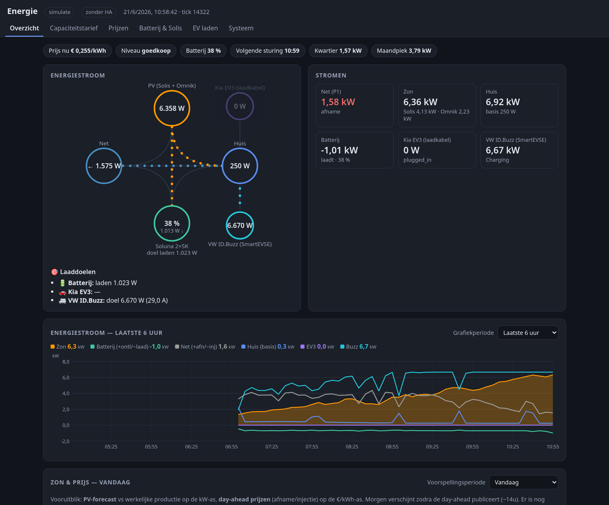
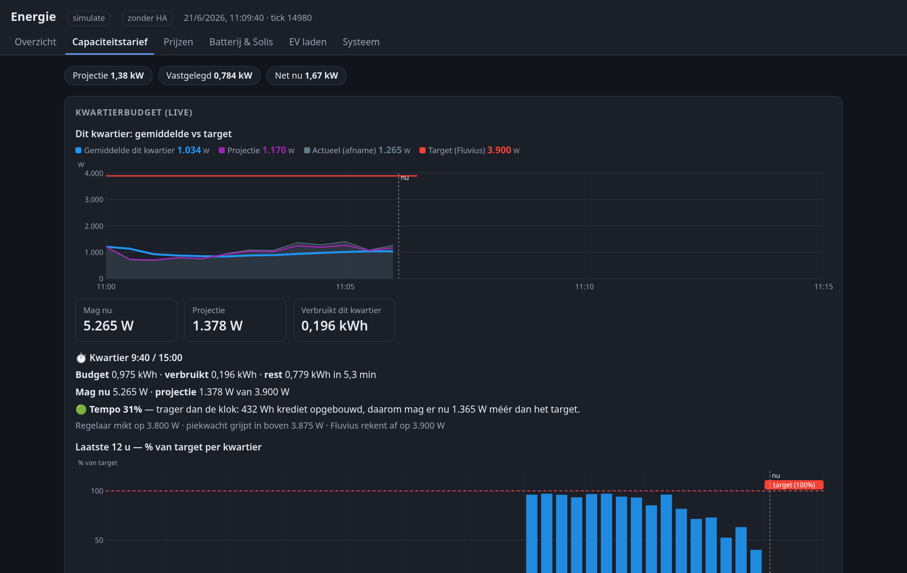
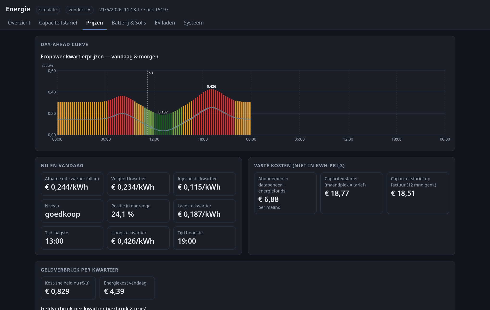
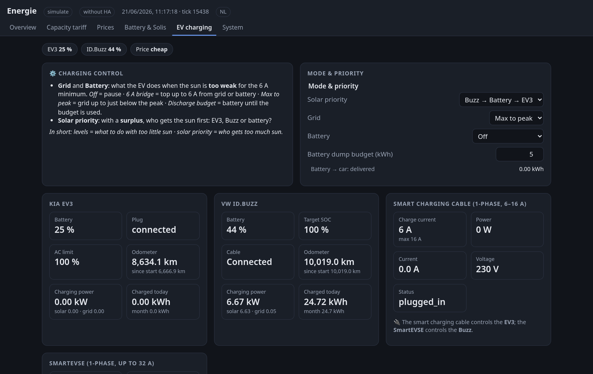

# energie

[](https://github.com/jeroentrappers/energie/actions/workflows/ci.yml)
[](LICENSE)

A self-hosted home energy controller written in Rust. It steers a home battery and two EV
chargers from a solar-surplus cascade, keeps the quarter-hour peak under the Belgian capacity
tariff, protects the main breaker, and shows it all on a built-in dashboard.

It is one small binary with no database or runtime. On a typical server it uses about 18 MB of
memory and 0.4 % of one CPU core. It can run on its own, or next to Home Assistant over MQTT.

**Website: [energie.appmire.be](https://energie.appmire.be)**

<picture>
  <source srcset="docs/images/overview-light.png" media="(prefers-color-scheme: light)">
  
</picture>

<sub>A simulated house at mid-morning.</sub>

> **Read this first.** energie writes to inverters and EV chargers. Wrong settings can
> overload a circuit, drain a battery or leave a car uncharged. Start in `shadow` or
> `dry_run` mode, keep your breakers and the inverter's own limits in place, and read
> [Safety](#safety). The software comes with no warranty.

## What it does

- **Solar-surplus cascade.** Every loop drives the grid meter toward zero. You choose the
  order in which the two cars and the battery take surplus solar power.
- **Capacity tariff.** Projects the running quarter-hour average and holds it under the
  monthly peak target, shedding loads when needed.
- **Breaker guard.** Limits charging per phase from the measured phase currents,
  independently of everything else.
- **Price-aware charging.** Uses day-ahead quarter-hour prices to decide when the grid may
  charge the battery or the cars, and curtails on negative injection prices.
- **Dashboard and API.** Live power flow, history, prices, per-device health and every
  setting, with no external services or CDN.
- **MQTT bridge.** Publishes every entity, accepts settings, and supports Home Assistant
  discovery.
- **Modes for trying it safely.** `simulate` runs against a built-in house model, `shadow`
  decides but never writes, and `[control] dry_run` works out each register write and logs it.

## Screenshots

| Capacity tariff | Prices | EV charging |
| --- | --- | --- |
|  |  |  |

## Is this for you?

energie began as the controller for one house and is still shaped by it. Before installing,
check that your setup fits:

| | Today |
| --- | --- |
| Location | Belgium. Local time is fixed to Europe/Brussels and the tariff logic follows Fluvius. |
| Battery | Optional. Controlling one uses the Solis remote-control model; other inverters need a driver that maps onto it. Solar with an EV and no battery works out of the box. |
| Chargers and cars | Exactly two named slots, `buzz` (SmartEVSE-style) and `ev3` (cable-style). Another brand can fill a slot with a new driver; a third charger needs logic changes. |
| Interface language | The dashboard is in English and Dutch, following the browser. Phone notifications are in Dutch. |
| Maturity | Version 0.x. About 950 automated tests, including a simulated-day comparison, but real-world control experience comes from a single installation. |

See [supported hardware](docs/HARDWARE.md) for each device. Contributions that make it more
general are very welcome.

## Quick start: try it without hardware

Download the archive for your platform from the
[releases page](https://github.com/jeroentrappers/energie/releases) and unpack it, then:

```sh
cat > sim.toml <<'EOF'
mode = "simulate"
listen = "127.0.0.1:8080"
state_dir = "./energie-state"
[sim]
speed = 60.0
EOF

./energie --config sim.toml
```

Open <http://127.0.0.1:8080> to watch a simulated house run at 60× speed. Nothing outside the
process is touched.

## Install

On Linux, the installer detects your architecture, checks the download against its published
checksum and sets up the systemd service without starting it:

```sh
curl -fsSL https://raw.githubusercontent.com/jeroentrappers/energie/main/scripts/install.sh -o install.sh
less install.sh     # read it first
sudo sh install.sh
```

With Docker, [`deploy/docker`](deploy/docker/README.md) has a ready-made Compose setup.

The [installation guide](docs/INSTALL.md) covers manual, Docker and from-source installs,
upgrades, and the steps from `shadow` to live control.

### Binaries

Each [release](https://github.com/jeroentrappers/energie/releases) includes checksums and
build provenance.

| Platform | Architectures | Status |
| --- | --- | --- |
| Linux (static, any distribution) | x86-64, ARM64, ARMv7, RISC-V 64 | Recommended |
| macOS | Apple Silicon, Intel | Supported for evaluation |
| Container image | `linux/amd64`, `arm64`, `arm/v7`, `riscv64` | `ghcr.io/jeroentrappers/energie` |
| Windows | x86-64, ARM64 | Experimental: secrets files are not permission-protected, and MQTT reconnection is untested |

## Documentation

| | |
| --- | --- |
| [Installation](docs/INSTALL.md) | Every install method, first-run checks, upgrades, removal |
| [Configuration](docs/CONFIGURATION.md) | The config file, key by key |
| [Supported hardware](docs/HARDWARE.md) | Devices, how to connect them, what each one needs |
| [Operations](docs/OPERATIONS.md) | Modes, the kill switch, monitoring, backups, troubleshooting |
| [Home Assistant](docs/HOME-ASSISTANT.md) | Running alongside HA, or taking over from it |
| [Architecture](docs/ARCHITECTURE.md) | How the code is organised |
| [All documents](docs/README.md) | Control-mode internals, MQTT, plug-ins, replay and more |

## Safety

- energie is a convenience layer. It doesn't replace breakers, RCDs, charger current limits
  or the inverter's own protections, and those must be installed and set correctly by a
  qualified person.
- **Kill switch:** the dashboard (*Systeem → Sturing*) or
  `POST /api/control {"enabled": false}` stops all writes immediately, and the stop survives
  restarts.
- **Battery fail-safe:** forced Solis modes always carry a timeout, so the inverter returns to
  self-use on its own within 10 minutes if energie stops or loses its connection.
- **EV chargers keep their last setting** if energie stops. See
  [what happens when it stops](docs/OPERATIONS.md#what-happens-when-energie-stops).
- **Authentication is enforced.** energie won't start with a dashboard or MQTT broker on the
  network unless sign-in is configured (OpenID Connect or a password), and settings can't be changed over MQTT unless you
  opt in. See [SECURITY.md](SECURITY.md).

## Building from source

Needs a current stable Rust toolchain:

```sh
cargo build --release -p energie
cargo test --workspace
```

## Contributing

Bug reports, drivers for new hardware and translations are all welcome. See
[CONTRIBUTING.md](CONTRIBUTING.md).

## License

Copyright © 2026 Jeroen Trappers.

energie is free software under the [GNU Affero General Public License v3.0 or
later](LICENSE). If you run a modified version as a network service, you must offer its source
code to the people who use it. Third-party notices are in [NOTICE.md](NOTICE.md).

This project is not affiliated with or endorsed by any manufacturer or service named here.
All trademarks belong to their owners. Some integrations use unofficial vendor interfaces,
which may change or stop working and may be subject to the vendor's terms: using them is your
responsibility.
